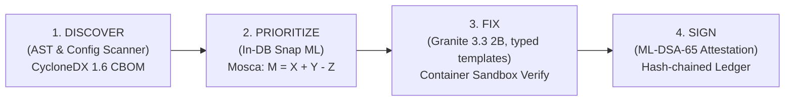
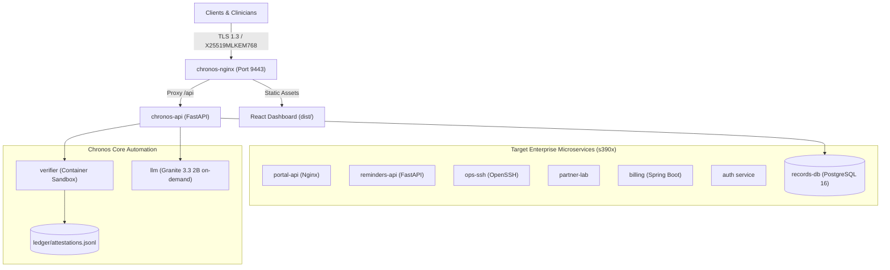

# Chronos

**Proactive Post-Quantum Cryptographic Agility & Remediation for IBM Z LinuxONE**  
*IBM Z Datathon 2026 — Theme 2: AI Secured: Innovation Without Exposure*

[-blue.svg)](#)
[](#)
[](#)
[](#)

> **Theme 2 Core Bridge:**  
> *"Chronos understands sensitive data without exporting it, then protects how it travels from here on."*

---

## The Threat: Harvest Now, Decrypt Later (HNDL)

Nation-states and well-funded adversaries are actively recording encrypted enterprise traffic across public internet and partner channels today. When a **Cryptanalytically Relevant Quantum Computer (CRQC)** emerges, Shor's algorithm will instantaneously break the classical asymmetric mathematics (RSA, ECDHE, ECDSA) protecting these recordings.

For high-confidentiality sectors running on IBM Z mainframes—healthcare (genomics, clinical data) and finance (banking records, government identity)—data has a legal retention shelf-life of **25 to 50 years**. Classical encryption will fail long before statutory confidentiality expires.

---

## The Solution: Discover → Prioritize → Fix → Sign

Chronos delivers an end-to-end, verified post-quantum agility lifecycle tailored for IBM Z LinuxONE microservices:



1. **Discover (CycloneDX 1.6 CBOM):** Scans codebases, configuration files (Nginx, OpenSSH), and live TLS endpoints to generate a standardized Cryptographic Bill of Materials.
2. **Prioritize (In-DB Profiling & Mosca's Theorem):** Identifies column-level sensitivity entirely inside PostgreSQL without exporting raw records. Applies Mosca's rule ($M = X + Y - Z$) to calculate which channels face immediate quantum exposure.
3. **Fix (Granite behind a typed boundary):** IBM Granite 3.3 2B Instruct (Q8_0, big-endian GGUF on llama.cpp) only picks one of three fix templates and its parameters under a JSON schema; deterministic code renders the diff, a validator gates it, a sandbox handshake test verifies hybrid `X25519MLKEM768` / `mlkem768x25519-sha256`, and a human approves. The model never writes the change itself.
4. **Sign (ML-DSA-65 Attestation Ledger):** Approves changes with post-quantum digital signatures (NIST FIPS 204 ML-DSA-65) chained into a tamper-evident SHA-256 hash-chained ledger.

---

## Architecture

Chronos inspects and protects seven enterprise microservices deployed in a simulated healthcare enterprise:



*Note on Architecture:* CPU-only execution on IBM LinuxONE s390x (NNPA neural hardware accelerator is not configured). Redis and the P1 real-time anomaly model were not built.

---

## Live Measured Results (from `out/metrics.json`)

All metrics cited in Chronos are derived directly from reproducible measurements on the IBM LinuxONE VM:

| Lifecycle Stage | Benchmark Metric | Measured Result | Evaluation Qualifier & Context |
|---|---|---|---|
| **Discovery** | CBOM Asset Recall | **0.933 baseline → 1.0 tuned** | 45 seeded cryptographic assets; scan completes in **1.18 seconds**. |
| **Discovery** | Grep Baseline Comparison | **100% vs 26.7% recall** | Regex/grep baseline misses 73% of indirect and structured crypto usages. |
| **Shelf-Life** | In-DB Classifier Macro F1 | **0.8207 (82.1%)** | Evaluated on 675 held-out synthetic columns (hospital, bank, school). |
| **Shelf-Life** | Under-Protection Error Rate | **4.15% (vs 28.4% baseline)** | Misleading column names test: 71.4% model F1 vs 4.9% keyword baseline. |
| **Shelf-Life** | Inference Latency | **0.094 ms / column** | Snap ML on s390x; **zero raw cell data egress** (aggregates only). |
| **Risk Modeling**| Total Exposure Index ($E$) | **668,000 → 78,000 (↓ 88.3%)** | Disclosed 70/30 hybrid client mix; 4 classical routes intentionally open. |
| **Remediation** | Template choice (20 seeded findings) | **20 / 20 correct, 0 / 10 validator bypasses** | Measured with the rules engine; the measured Granite run fell back to rules on timeout, so this is not a Granite accuracy figure. |
| **Remediation** | Sandbox Verification Time | **5.9 s (portal) to 20.9 s (lab-api)** | One sandbox container per fix: hybrid handshake, classical-compat client, health; T1, T2 and T3 all passed. |
| **Attestation** | Post-Quantum Signature | **ML-DSA-65 (FIPS 204)** | Chained SHA-256 hashes (`prev_hash`); public key downloadable in PEM format. |

---

## Quickstart Guide

### Prerequisites
- IBM LinuxONE VM (`s390x`) or Ubuntu 24.04 environment.
- Docker & Docker Compose with support for OpenSSL 3.5.5 / `oqsprovider`.
- Python 3.12+ and Node.js 22+.

### 1. Launch the Stack
```bash
# Clone the repository
git clone https://github.com/Oxyrine/Chronos.git
cd Chronos

# Run the complete orchestration build and startup script
bash scripts/run_all.sh
```

`run_all.sh` will:
1. Build the base container images with ML-KEM-768 and ML-DSA-65 support.
2. Initialize PostgreSQL tables and generate synthetic clinical datasets.
3. Generate secure random credentials stored in `.env` (scrypt hashes).
4. Launch the microservices, verification worker, and Chronos API.

### 2. Access the Operations Console
Because the Nginx frontend binds to `127.0.0.1:9443` for security, tunnel to the host:
```bash
ssh -L 9443:127.0.0.1:9443 user@linuxone-vm
```
Open **`https://localhost:9443`** in a browser supporting post-quantum TLS (Chrome 124+ or Firefox 130+).

### 3. Role-Based Access Control
| User | Role | Permissions |
|---|---|---|
| **`secops`** | `security_engineer` | Run scans, override sensitivity classes, synthesize patches, verify in sandbox, approve deployments & sign ML-DSA ledger. |
| **`viewer`** | `viewer` | Read-only access to CBOM inventory, Mosca heat maps, and attestation logs. |

*Security Guards:*
- Session tokens use PyJWT HS256 stored in `HttpOnly; SameSite=Strict; Secure` cookies.
- Brute force protection limits failed logins to 5 attempts per 15 minutes per username + IP.
- Mutation endpoints (`POST`, `PUT`, `DELETE`) strictly require `security_engineer` role (with `/api/auth/login` and `/api/auth/logout` exempt).
- Sessions are `httpOnly`, `Secure`, `SameSite=Strict` cookies signed with `CHRONOS_JWT_SECRET`; the API refuses to issue sessions if that secret is missing.
- Sample mode (`CHRONOS_USE_SAMPLES=1`) still requires a login. For local UI work set `CHRONOS_ALLOW_DEV_PASSWORDS=1` to enable `viewer`/`viewer` and `secops`/`secops`; they are refused whenever sample mode is off.

### 4. Running Tests
```bash
# Activate virtual environment
source .venv/bin/activate

# Execute complete pytest suite (158 unit & integration tests)
pytest -v
```

### 5. Resetting the Demo Environment
To return all microservices to their vulnerable baseline state:
```bash
bash scripts/reset_demo.sh
```

### 6. Granite Proposals on the VM

Granite runs on demand (`llm` compose profile, never alongside a sandbox run). Measured on the L1CC VM it reads about 14.5 prompt tokens/s and writes about 5.9 tokens/s, so proposals are pre-generated right after a scan rather than on the demo click:

```bash
docker compose --profile llm up -d llm
docker compose exec -e CHRONOS_AGENT_MODE=granite chronos-api python -m chronos.agent.pregenerate
docker compose exec chronos-api python -m chronos.agent.eval --granite
docker compose stop llm
```

The client sends a cached static prefix (instructions and template catalog), a 12-line excerpt and at most 160 output tokens. `CHRONOS_LLM_TIMEOUT` (default 90 s), `CHRONOS_LLM_CONTEXT_LINES` and `CHRONOS_LLM_MAX_TOKENS` tune it. Any timeout falls back to rules and is recorded per proposal (`model: rules-only`, `fallback_reason`), never relabelled as Granite.

---

## Repository Structure

```
Chronos/
├── chronos/                  # Python core package
│   ├── agent/                # Granite 3.3 2B agent, deterministic T1–T3 renderers, validator
│   ├── api/                  # FastAPI shell, auth, session cookies, routers
│   ├── discovery/            # AST parsers, config scanners, CBOM generator
│   ├── risk/                 # Mosca formula (M = X + Y - Z) & exposure scoring
│   ├── shelflife/            # In-DB column sensitivity profiling (Snap ML)
│   └── verify/               # Sandbox verifier & ML-DSA attestation engine
├── dashboard/                # Production React + Vite + TypeScript web console
│   ├── src/pages/            # Overview, Inventory, Shelflife, Remediation, Ledger
│   ├── src/components/       # Navbar, Footer (with live X-TLS-Group curve detection)
│   └── dist/                 # Pre-built distribution served by chronos-nginx
├── demo/                     # Microservice definitions, configs, and certs
├── docker/                   # Container definitions (nginx, pybase, verifier)
├── docs/                     # Technical documentation & submission materials
│   ├── primer.md             # Spec §16 Q&A and §9.1 algorithm guide
│   ├── model_card.md         # Snap ML classifier card & limits
│   └── deck_and_video.md     # 10-slide deck outline & ~3-min video script
├── out/                      # Reproducible benchmark metrics (metrics.json, bench.json)
└── scripts/                  # run_all.sh, reset_demo.sh, demo_flow.py
```

---

## License & Compliance
Built for the **IBM Z Datathon 2026**. Designed to adhere to **NIST FIPS 203 (ML-KEM)**, **NIST FIPS 204 (ML-DSA)**, **NSA CNSA 2.0**, and **BSI TR-02102-1**.
