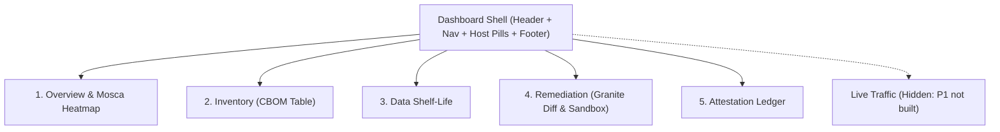

# Chronos: Person C Implementation Plan (API Shell, Dashboard, Story)

## Context
Chronos (IBM Z Datathon 2026) finds data that can be recorded today and decrypted by a future quantum computer, ranks it by how long it must stay secret (Mosca's rule: $M = X + Y - Z$), and fixes the worst channels with verified, ML-DSA-signed post-quantum config changes.

Three-person split:
- **A**: Crypto, infrastructure, demo stack, verifier worker, ML-DSA ledger (`docs/PLAN_PERSON_A.md`).
- **B**: Data, in-DB profiling, Snap ML shelf-life classifier, Mosca engine, API contracts (`docs/HANDOFF_B.md`).
- **C**: **API shell (auth, role mapping, metrics/health), dashboard (`dashboard/`), and the submission story (README, deck, primer, video script, submission checklist)**.

**Person A and Person B are merged and verified** (`main` at `e6f63a6`). Every backend endpoint the dashboard needs exists and runs on the LinuxONE VM. What is missing is all of Person C's lane: there is currently no `dashboard/` directory, no login (interim `owner()` bearer check gives every caller secops), no README, no deck, no video. Judges see the dashboard, the README, and the video, so C is on the critical path.

---

## 0. What already exists (reuse, don't rebuild)

| Piece | Where | Notes for C |
|---|---|---|
| API app | `chronos/api/app.py` | Mounts all routers under `/api`. Public `GET /health` returns `{status, arch}`. C replaces interim `owner()` with real JWT cookie login + role guard. |
| Auth seam | `chronos/api/deps.py:current_user` | Every router depends on it; returns `{"sub", "role"}`. Approve already checks `role == "security_engineer"` in both API (`routers/verify.py`) and worker (`verify/attest.py`). |
| Data contracts | `contracts/*.schema.json`, `contracts/samples/*.json` | Generate TypeScript types via `json-schema-to-typescript`; never hand-write shapes. |
| Sample mode | `CHRONOS_USE_SAMPLES=1` | Every route serves contract samples: build and test the UI on the laptop with zero backend dependencies. |
| Dashboard hosting | `compose.yml` (`chronos-nginx`) + `docker/nginx/nginx.conf` | Serves `dashboard/dist` at `https://localhost:9443` over **hybrid PQ TLS** (`X25519MLKEM768`), proxies `/api/` to `chronos-api`; strict CSP `default-src 'self'; frame-ancestors 'none'`, HSTS, nosniff, no-referrer; bound to `127.0.0.1` (reach via SSH tunnel). |
| End-to-end API flow | `scripts/demo_flow.py` | The exact call sequence the Remediation screen must follow (propose $\rightarrow$ verify $\rightarrow$ poll $\rightarrow$ approve $\rightarrow$ ledger verify). |
| Measured numbers | `out/metrics.json` (+ `out/bench.json`, `out/agent_eval.json`) | The **only** source for all numbers in the dashboard Overview, README, deck, and video. |
| Model card / handoffs | `docs/model_card.md`, `docs/HANDOFF_B.md`, `docs/PLAN_PERSON_A.md` | Caveats and qualifiers the deck and README must carry. |

### API surface the dashboard calls (all under `/api`, JSON)

| Screen | Endpoint | Method | Returns |
|---|---|---|---|
| Auth | `/api/auth/login` | POST | `{sub, role}` + sets `httpOnly` cookie |
| | `/api/auth/logout` | POST | Clears cookie |
| | `/api/me` | GET | `{sub, role}` |
| Health / Meta | `/health` | GET | `{status, arch, nnpa, tls_groups}` |
| | `/api/metrics` | GET | Complete contents of `out/metrics.json` |
| Inventory | `/api/scan` | POST | `{scan_id}` (secops only) |
| | `/api/scan/{id}` | GET | `{scan_id, status: running\|done\|failed, findings, scan_seconds}` |
| | `/api/findings?status=&service=` | GET | `Finding[]` (contract `finding`, plus `method`, `fingerprint`) |
| | `/api/cbom` | GET | CycloneDX 1.6 JSON (`cbom`) |
| Shelf-life | `/api/shelflife/run` | POST | `{job_id, columns}` (secops only) |
| | `/api/shelflife` | GET | `ShelfLifePrediction[]` (category, policy_years, probabilities, decided_by, top_features) |
| | `/api/shelflife/{table}/{column}/override` | POST | Override record (logged to `out/overrides.jsonl`; secops only) |
| Overview / Twin | `/api/exposure?scenario=early_2030\|base_2033\|late_2035\|custom_YYYY` | GET | `{exposures: Exposure[], E, already_sent, client_mix_measured, note}`; **409** if scan/classification hasn't run |
| Remediation | `/api/priorities?scenario=` | GET | `Finding[]` ranked by priority (0–100) |
| | `/api/proposals` | POST | `{proposal, finding, target, diff, rendered, state, latency_s}` (secops only) |
| | `/api/proposals` | GET | `ProposalRecord[]` |
| | `/api/proposals/{id}` | GET | `ProposalRecord` |
| | `/api/proposals/{id}/verify` | POST | 202 `{proposal_id, status: pending}` (secops only) |
| | `/api/verifications/{id}` | GET | `VerificationResult` (`status: pending\|passed\|failed`, `checks[...]`, `log_path`) |
| | `/api/proposals/{id}/approve` | POST | Attestation entry (secops only) |
| Ledger | `/api/ledger` | GET | `Attestation[]` |
| | `/api/ledger/verify` | GET | `{chain_ok, bad_seq}` |
| | `/api/ledger/public-key` | GET | ML-DSA-65 public key (PEM) |
| | `/api/ledger/{seq}/evidence/{cbom\|verification\|proposal}` | GET | Hash-checked evidence JSON download |

---

## 1. Timeline & Phasing

| Phase | Duration | Focus | Exit Check |
|---|---|---|---|
| **0. Setup** | 30 min | Verify Python/Node environment. Scaffold `dashboard/`, install dependencies, generate TypeScript types from `contracts/*.schema.json`. Test sample mode locally. | `npm.cmd run dev` renders basic page from local sample mode. |
| **1. Auth & API Shell** | 1.5 h | Implement `chronos/api/auth.py`, update `chronos/api/app.py`, add `chronos/api/routers/meta.py`. Add `python3-jwt` to `docker/pybase/Dockerfile` and `requirements.txt`. Write `tests/test_auth.py`. | `pytest tests/test_auth.py` green; all 148 regression tests pass. |
| **2. Screens** | 3.5 h | Build 5 P0 screens (Overview, Inventory, Shelf-life, Remediation, Ledger) + Login. Pure CSS/Tailwind-like styled components without inline styles. Strict CSP compliance. | Every screen renders cleanly; sample mode and live proxy both function. |
| **3. Demo Flow & Testing** | 1.0 h | Verify end-to-end flow with `scripts/demo_flow.py`. Verify `scripts/reset_demo.sh`. Check timed run under 3 minutes with zero browser console errors. | Clean browser console; timed walkthrough < 3 min. |
| **4. Story & Submission** | 2.5 h | Create `README.md`, `docs/primer.md`, update `docs/model_card.md`, write 10-slide deck outline, and ~3-min video script. Tick off submission checklist. | Deliverables ready for final packaging and submission. |

---

## 2. API Shell: Real Login and Roles (`chronos/api/`)

Replace interim `owner()` check with production spec §7.9 auth:
Two users:
- **`viewer`**: read-only audit and compliance role.
- **`secops`**: role `security_engineer` (the only approver and remediator).

### Implementation Details:
1. **`chronos/api/auth.py`**:
   - `POST /api/auth/login {username, password}`:
     - User accounts and scrypt password hashes loaded from `.env` (`CHRONOS_USERS=viewer:<salt>$<hash>,secops:<salt>$<hash>`).
     - Verification via `hashlib.scrypt(password.encode(), salt=salt, n=16384, r=8, p=1)`.
     - Constant-time comparison (`hmac.compare_digest`).
     - Uniform error message: `"invalid credentials"` for both unknown user and bad password.
     - Rate limiter: Maximum 5 failed attempts per username + client IP (`X-Real-IP` when behind Nginx) within 15 minutes $\rightarrow$ returns HTTP 429.
   - JWT generation & cookie:
     - PyJWT HS256 with secret `CHRONOS_JWT_SECRET`. Claims: `sub`, `role`, `exp` (8 hours), `iat`.
     - Sets `chronos_session` cookie: `httponly=True`, `secure=True`, `samesite="strict"`, `path="/"`.
   - `POST /api/auth/logout`: Clears `chronos_session` cookie (`max_age=0`).
   - `GET /api/me`: Returns `{"sub": user["sub"], "role": user["role"]}` so UI can dynamically adapt controls.

2. **`chronos/api/app.py`**:
   - Updates `current_user` dependency:
     - First checks `chronos_session` cookie.
     - Fallback: checks `Authorization: Bearer <token>` against `CHRONOS_API_TOKEN` (maps to `sub="secops", role="security_engineer"` for CLI scripts/automation).
     - Missing or invalid credentials $\rightarrow$ HTTP 401.
   - **Critical Route Exemption Rule**:
     - Global mutation guard: all non-GET/HEAD/OPTIONS requests require `role == "security_engineer"`.
     - **Explicit Exemption**: `POST /api/auth/login` and `POST /api/auth/logout` MUST be exempt from the mutation guard so unauthenticated users can log in, and viewers can log out!
   - Enriched `GET /health` (public):
     - Returns `{status: "ok", arch: platform.machine(), nnpa: False, tls_groups: ["X25519MLKEM768", "X25519"]}`.
     - Never claims NNPA acceleration (checks `/proc/cpuinfo`, defaults to `False`).

3. **`chronos/api/routers/meta.py`**:
   - `GET /api/metrics`: Read-only endpoint serving `out/metrics.json` with `Cache-Control: no-store`. Overview screen queries this so all baseline numbers are verifiable against an API response.

4. **Dependencies**:
   - `docker/pybase/Dockerfile`: Add `python3-jwt` to `apt-get install`.
   - `requirements.txt`: Add `pyjwt>=2.8.0`.

5. **`tests/test_auth.py`**:
   - Successful login and cookie attributes.
   - Rejection on wrong password and unknown user.
   - Rate limit lockout after 5 consecutive failures.
   - Cookie expiration and logout.
   - `viewer` gets HTTP 403 on mutative endpoints (`/api/scan`, `/api/shelflife/patients/ssn/override`, `/api/proposals`, `/api/proposals/{id}/verify`, `/api/proposals/{id}/approve`).
   - `secops` succeeds on mutative endpoints.
   - Bearer token authentication remains intact for scripts.
   - `GET /health` and `GET /api/metrics` remain publicly readable.

---

## 3. Dashboard (`dashboard/`, React + Vite + TypeScript + Recharts)

### Setup & Tooling
- Scaffolded using Vite `react-ts`.
- Dependencies: `react`, `react-dom`, `react-router-dom`, `recharts`, `lucide-react`.
- Contract types: generated via `npx.cmd json-schema-to-typescript contracts/*.schema.json` into `src/types/contracts.ts`.
- API client `src/api.ts`:
  - `fetch` with `credentials: 'same-origin'`.
  - Captures `X-TLS-Group` response header from `/health` to display the active TLS curve.
  - Automatically handles 401 (redirect to login), 403 (show toast/notice "secops role required"), and 409 (guided prompt: "Run a discovery scan and classification first").
- Strict CSP compliance:
  - Nginx header: `default-src 'self'; frame-ancestors 'none'`.
  - No external fonts (Inter/system sans bundled locally).
  - No external CDNs or analytics.
  - Diffs and logs rendered safely in `<pre>` using element-based coloring for `+` and `-` lines (no `dangerouslySetInnerHTML`).

### Screen Architecture



#### 1. Overview Screen (`/`)
- **Headline Exposure Card**:
  - Live data from `GET /api/metrics` and `GET /api/exposure`.
  - Future-transfer exposure: Baseline $E = 668,000 \rightarrow$ Remediated $E = 78,000$ ($-88.3\%$).
  - Disclosed 70/30 client mix: 70% hybrid-capable, 30% legacy.
  - Historical data disclosure ($R$): 36,063 records already sent over classical channels (cannot be undone by remediation).
  - Open classical routes panel: lists channels that still accept classical handshakes.
  - Provenance tooltips: *"from GET /api/exposure"* and *"from GET /api/metrics"*.
- **CRQC Arrival Slider**:
  - Scenarios: Early (2030), Base (2033), Late (2035), or Custom Year.
  - Re-computes live via `GET /api/exposure?scenario=...` in < 500 ms.
- **Mosca Heat Map Grid**:
  - Tables $\times$ Channels matrix.
  - Formula: $\mathbf{M = X + Y - Z}$ where:
    - $X$ = Shelf-life (years required for confidentiality).
    - $Y$ = Migration time (years required to transition the channel).
    - $Z$ = Years until Cryptanalytically Relevant Quantum Computer (CRQC).
  - Cell background encodes margin $M$; prominent red outline highlights exposed combinations ($M > 0$ and $q > 0$).
- **Portal vs. Reminders Contrast Card**:
  - Side-by-side comparison of `internet->portal` and `internet->reminders`.
  - Identical classical crypto (Nginx TLS 1.3 with classical P-256 / RSA), but starkly different urgency driven by data retention:
    - `portal` carries `patients.blood_group` ($X = 50$ years) $\rightarrow$ Priority 94.0.
    - `reminders` carries `appointment_reminders.patient_id` ($X = 10$ years) $\rightarrow$ Priority 70.0.
- **Regulatory Deadline Countdowns**:
  - 31 Dec 2026: EU high-priority agency migration planning.
  - 31 Dec 2030: NIST deprecation of classical public-key cryptography.
- **System Badges**:
  - Host: `s390x` (LinuxONE).
  - Hardware Acceleration: `NNPA: no` (CPU Snap ML execution accurately reported).

#### 2. Inventory Screen (`/inventory`)
- CycloneDX 1.6 CBOM table: asset name, component type, algorithm, key parameters/curves, source location (`path:line`), quantum status badge (`vulnerable`, `weakened`, `resistant`), classical-weak flag.
- Discovery method tag: identifies how each asset was discovered (`ast`, `regex`, or `method: ai` for tuned discovery).
- Filtering: by quantum status (`vulnerable`/`all`) and service (`portal`, `reminders`, `lab-api`, `ops-ssh`).
- Actions:
  - "Run Discovery Scan" (`POST /api/scan`) with live polling bar.
  - "Download CBOM JSON" (`GET /api/cbom`).

#### 3. Data Shelf-Life Screen (`/shelflife`)
- Column profiling & classification table: table name, column name, predicted category, policy retention years ($X$), model confidence scores (top 4 probabilities), salient structural features.
- In-Database Privacy Guarantee Banner: *"Data Minimization: No raw database cells ever leave the PostgreSQL container. Predictions are generated from in-database structural aggregates and pattern hits."*
- Table roll-up indicator: clearly marks the driving column (e.g. `otp_codes` table is retained for 10 years due to the `phone` column, not 1 day for `code`).
- Actions:
  - "Run Classification" (`POST /api/shelflife/run`).
  - "Override Category" modal: disabled for `viewer`, enabled for `secops`, requiring operator identity and justification reason.

#### 4. Remediation Screen (`/remediation`)
- Ranked Priority Queue (0–100) from `GET /api/priorities`.
- Proposal Card:
  - Finding summary and Granite 3.3 recommendation rationale.
  - Template selector: `T1_nginx_hybrid_groups`, `T2_sshd_hybrid_kex`, `T3_client_tls_groups`.
  - Mode toggle: Compatibility mode (retains classical fallback) vs. Strict mode (TLS 1.3 + ML-KEM only).
  - Rendered unified diff: syntax-colored using React elements (`span` with green/red backgrounds; NO `dangerouslySetInnerHTML`).
- Three-Step Remediation Pipeline:
  1. **Propose** (`POST /api/proposals`).
  2. **Verify in Sandbox** (`POST /api/proposals/{id}/verify`): polls status every 2 seconds, displaying container sandbox test output, ML-KEM handshake negotiation, and legacy fallback verification.
  3. **Approve & Attest** (`POST /api/proposals/{id}/approve`): secops-only confirmation modal displaying diff SHA-256 and signing prompt.

#### 5. Ledger Screen (`/ledger`)
- Hash-chained attestation timeline: sequence number (`seq`), timestamp (`ts`), proposal ID, approved by (`secops`), verification SHA-256, CBOM SHA-256, diff SHA-256, previous entry hash (`prev_hash`), signature algorithm (`ML-DSA-65`), Base64 signature preview.
- Chain Integrity Banner: live status indicator from `GET /api/ledger/verify` (`chain_ok: true` in green).
- Evidence Downloads: hash-verified downloads for CBOM snapshot, sandbox verification log, and proposal diff.
- Required Standard Disclaimer: *"A cryptographic signature proves who attested to which evidence in an isolated sandbox; it does not claim the patch is secure in every respect."*

#### 6. Live Traffic Screen (P1)
- Explicitly marked as hidden/omitted: *"Live traffic streaming and real-time anomaly detection were designed as Phase 1 extensions and not included in the core competition build."*

---

## 4. Demo Operations & Recording Runbook

### Scripts & Container Management
1. **Resetting Between Takes**:
   - Create `scripts/reset_demo.sh` to restore planted vulnerable configs, archive `ledger/attestations.jsonl` to `ledger/archive/<timestamp>.jsonl`, restart demo services, run fresh discovery scan, and re-run shelf-life classification.
2. **Granite & Sandbox Exclusivity**:
   - The verifier worker refuses to execute while the `llm` container is active (memory constraint).
   - Sequence: `docker compose --profile llm up -d llm` $\rightarrow$ create proposals $\rightarrow$ `docker compose stop llm` $\rightarrow$ execute sandbox verification.
3. **Recording Strategy & Time Budget**:
   - Verification takes ~40s and service rebuild takes ~10s.
   - For live 3-minute video presentation: pre-stage one proposal in `verified_awaiting_approval` state. Propose and verify a second proposal on-screen while narrating, then approve the pre-staged one live.
4. **Browser & Network Setup**:
   - Import `demo/ca/ca.pem` into the browser's certificate authority store so no untrusted certificate warning appears.
   - Forward port: `ssh -L 9443:localhost:9443 linux1@<vm>`.

---

## 5. Demo Script (~3 Minutes, Spec §14)

- **0:00 - 0:25 | Context & Theme 2 Bridge**:
  - Terminal: `uname -m` $\rightarrow$ `s390x`, `curl -k https://localhost:9443/health`.
  - Narration: *"Everything you see runs on IBM LinuxONE. In healthcare, patient data has a shelf-life that outlasts classical cryptography. Under Theme 2 ('AI Secured: Innovation Without Exposure'), Chronos understands sensitive data without exporting it, then protects how it travels from here on."*
- **0:25 - 0:45 | Narrative Spine: Discover**:
  - Inventory screen: click Scan, view CBOM table, click Download CBOM.
  - Narration: *"First, Discover: Chronos inventories cryptography across configs, code, and live endpoints into OWASP CycloneDX 1.6 format, contributed by IBM Research."*
- **0:45 - 1:15 | Narrative Spine: Prioritize (Shelf-life & Mosca)**:
  - Shelf-life screen $\rightarrow$ Overview heatmap.
  - Narration: *"Next, Prioritize: Snap ML on s390x classifies data retention inside the database container. Genomics data requires 75 years of confidentiality. Using Mosca's theorem ($M = X + Y - Z$), we identify exposed channels. Notice the Portal vs. Reminders comparison: identical cryptography, but portal holds blood group data ($X=50$), while reminders holds appointment IDs ($X=10$). Same crypto, vastly different urgency."*
- **1:15 - 2:15 | Narrative Spine: Fix (Granite & Sandbox)**:
  - Remediation screen: inspect top proposal, Granite template selection, rendered diff.
  - Narration: *"Third, Fix: Granite 3.3 selects an approved hybrid template. The proposal is verified in an isolated Docker sandbox, confirming hybrid key exchange while legacy clients still connect."*
- **2:15 - 2:40 | Narrative Spine: Sign (ML-DSA-65 Ledger)**:
  - Approve action $\rightarrow$ Ledger screen.
  - Narration: *"Finally, Sign: A security engineer approves the change. An ML-DSA-65 post-quantum signature is anchored into the immutable ledger, proving who verified what evidence."*
- **2:40 - 3:00 | Results & Impact**:
  - Overview screen: Before vs. After exposure.
  - Narration: *"Future-transfer exposure fell by 88.3% under our 70/30 client mix, while classical routes and legacy clients remain transparently tracked. Free for hospitals and humanitarian NGOs."*

---

## 6. Story & Submission Deliverables

1. **`README.md`**:
   - 3-sentence executive problem summary + Theme 2 bridge.
   - Narrative spine: Discover $\rightarrow$ Prioritize $\rightarrow$ Fix $\rightarrow$ Sign.
   - Component architecture diagram: 7 demo services + chronos-nginx, chronos-api, verifier, llm.
   - Quickstart (LinuxONE VM & local sample mode).
   - LinuxONE proofs: `s390x`, `lscpu`, `/health` JSON, CPU-only Snap ML confirmation.
   - Verified metrics table directly from `out/metrics.json` with all qualifiers:
     - Discovery Recall: 0.933 measured baseline (1.0 tuned after gap closure).
     - Shelf-life F1: 0.821 (School held-out optimistic, synthetic data).
     - Future-transfer exposure: $668,000 \rightarrow 78,000$ ($-88.3\%$, 70/30 client mix, 4 classical routes still open).
     - Performance: Scan 1.187s, classify 0.094 ms/col (CPU-only, no NNPA).
2. **`docs/primer.md`**:
   - Spec §16 judge Q&A table (1–2 sentences per answer).
   - Spec §9.1 cryptographic algorithm classification table.
3. **`docs/model_card.md`**:
   - Update Results section with verified VM metrics.
4. **Presentation Deck (10 Slides)**:
   - Slide 1: Title & Theme 2 Hook.
   - Slide 2: The Problem: Harvest Now, Decrypt Later in Healthcare.
   - Slide 3: Regulatory Deadlines: NIST 2030/2035, EU 2026/2030.
   - Slide 4: Core Insight: Same Crypto, Different Data, Different Urgency ($M = X + Y - Z$).
   - Slide 5: The Workflow: Discover $\rightarrow$ Prioritize $\rightarrow$ Fix $\rightarrow$ Sign.
   - Slide 6: Architecture on LinuxONE (s390x).
   - Slide 7: AI with Boundaries: In-DB Snap ML + Granite 3.3 Templating (2 AI models, no NNPA).
   - Slide 8: Measured Results (with required qualifiers).
   - Slide 9: Impact & Enterprise Alignment (Free tier for healthcare/NGOs; complements IBM Guardium).
   - Slide 10: Team & Roadmap.
5. **Submission Checklist (Spec §17)**:
   - [ ] Discord confirmations of deadline, video length, and format recorded.
   - [ ] Team lab completion confirmed.
   - [ ] `out/bench.json` un-ignored and committed to git.
   - [ ] Valid `out/cbom.json` committed.
   - [ ] No-secrets check: `git ls-files | grep -Ei 'key|pem|jks|env'` returns zero tracked secrets.
   - [ ] Temporary files cleared (`out/pytest*`, `graphify-out/`).
   - [ ] All team members have read `docs/primer.md`.
   - [ ] Ready for submission 1 hour prior to deadline.

---

## 7. Verification Plan

### Automated Tests
```powershell
# 1. Auth & Shell Tests
& .\.venv\Scripts\pytest.exe tests/test_auth.py -v

# 2. Complete Regression Suite
& .\.venv\Scripts\pytest.exe -q

# 3. Frontend Build & Typecheck
cd dashboard
npm.cmd run build
npx.cmd tsc --noEmit
cd ..
```

### Manual Walkthrough
1. Start API in sample mode: `CHRONOS_USE_SAMPLES=1 & .\.venv\Scripts\python.exe -m uvicorn chronos.api.app:app --port 8000`.
2. Start Vite dev server: `npm.cmd --prefix dashboard run dev`.
3. Test login with `viewer` and `secops`. Verify `viewer` receives 403 on Approve/Override/Scan.
4. Walk through all 5 screens in under 3 minutes with zero browser console errors.
5. Verify `scripts/demo_flow.py` passes with bearer token.
