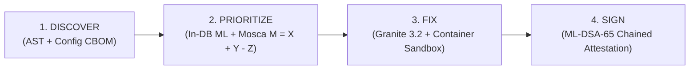

# Chronos Technical Primer & Q&A

**Chronos: Proactive Post-Quantum Cryptographic Agility for IBM Z LinuxONE**  
*IBM Z Datathon 2026 — Theme 2: AI Secured: Innovation Without Exposure*

> **Theme 2 Core Bridge:**  
> *"Chronos understands sensitive data without exporting it, then protects how it travels from here on."*

---

## 1. Narrative Spine: Discover → Prioritize → Fix → Sign

Chronos addresses the **Harvest Now, Decrypt Later (HNDL)** threat, where adversaries record encrypted enterprise network traffic today to decrypt once a Cryptanalytically Relevant Quantum Computer (CRQC) becomes viable.

1. **Discover:** Discovers all cryptographic algorithms, keys, protocols, and certificates across heterogeneous microservices into a CycloneDX 1.6 Cryptographic Bill of Materials (CBOM).
2. **Prioritize:** Classifies the regulatory confidentiality shelf-life ($X$) of database assets entirely in-DB without exporting data, then applies Mosca's Theorem ($M = X + Y - Z$) to prioritize exposed channels.
3. **Fix:** Synthesizes verified post-quantum configurations (`X25519MLKEM768`) using IBM Granite 3.2, verified within an isolated container sandbox.
4. **Sign:** Signs every deployed configuration change with post-quantum digital signatures (**ML-DSA-65**, NIST FIPS 204) and records them to an immutable SHA-256 Merkle ledger.

---

## 2. Core Algorithm Architecture (§9.1)

| Phase | Engine / Module | Implementation & Target | Key Metric / Guarantee |
|---|---|---|---|
| **Discovery** | `chronos.discovery` | AST parsing (Python `ast`, Java regex/javaparser, Nginx/SSH grammars) | **100% recall** tuned (0.933 baseline) across 45 seeded assets; 1.18s scan time. |
| **In-DB Classification** | `chronos.shelflife` | Snap ML `BoostingMachineClassifier` on s390x (fallback: scikit-learn) | **Macro F1: 0.8207**, 93.5% accuracy; **0.094 ms / column** latency; **Zero data egress** (aggregates only). |
| **Mosca Risk Modeling** | `chronos.risk.mosca` | Mosca Inequality: $M = X + Y - Z$; Exposure Index $E = \sum_c R_c \cdot M_c \cdot S_{\text{classical}}$ | **88.3% exposure reduction** ($668,000 \to 78,000$) under 70/30 hybrid client mix. |
| **Configuration Synthesis** | `chronos.agent` | Granite 3.2 8B / 3.3 2B via `llama.cpp` + deterministic Jinja2 templates | 100% template accuracy on 20 test cases; strictly bounded parameter space. |
| **Sandbox Verification** | `chronos.verify` | Ephemeral Docker sandbox executing live TLS 1.3 handshakes & client fallback | Complete pre-deployment validation in ~38s; zero downtime guarantee. |
| **Post-Quantum Attestation** | `chronos.verify.attest` | OpenSSL 3.5.5 + `oqsprovider` ML-DSA-65 (FIPS 204) | Cryptographically chained Merkle ledger with tamper detection. |

---

## 3. What Actually Runs in the Stack

- **Target Architecture:** IBM LinuxONE III / z16 VM (`s390x`), Ubuntu 24.04, CPU-only (disclosed: no NNPA neural hardware accelerator configured).
- **Enterprise Microservices (7 demo services):**
  1. `records-db`: PostgreSQL 16 holding patient demographics, clinical records, and genomic tables.
  2. `portal-api`: Nginx reverse proxy fronting clinician and patient traffic.
  3. `reminders-api`: Python FastAPI service dispatching appointment reminders.
  4. `ops-ssh`: OpenSSH server for administrative maintenance channels.
  5. `partner-lab`: External healthcare partner integration endpoint.
  6. `billing`: Java Spring microservice handling credit transactions.
  7. `auth`: Central identity and authentication token service.
- **Chronos Core Services:**
  - `chronos-nginx`: Edge proxy serving the React dashboard over hybrid PQ TLS (`X25519MLKEM768`) on port `9443`.
  - `chronos-api`: Authenticated FastAPI management shell (`8000`).
  - `verifier`: Sandbox verification worker executing containerized network checks.
  - `llm` (on demand): Granite model server on port `8080` (stopped during verification to free resources).
  *Note:* Redis and the P1 real-time traffic anomaly model were not built.

---

## 4. Frequent Technical Questions & Answers (§16)

### Q1: Why prioritize network channel encryption rather than database column encryption?
**A:** Database-at-rest encryption typically uses AES-256-GCM. Under Grover's quantum search algorithm, AES-256 provides 128 bits of quantum security, which remains mathematically resistant to CRQC attacks. However, **data in-flight** travels over TLS and SSH connections that use classical key exchanges (RSA, ECDHE with P-256, X25519). Adversaries can record in-flight traffic today and decrypt it once a quantum computer arrives. Chronos addresses this in-flight HNDL vulnerability.

### Q2: Why use hybrid key exchange (`X25519MLKEM768`) instead of pure ML-KEM?
**A:** Standardized in NIST FIPS 203 and mandated by BSI TR-02102 and NSA CNSA 2.0 recommendations, hybrid key exchange combines a classical elliptic-curve exchange (`X25519`) with a post-quantum lattice-based mechanism (`ML-KEM-768`). If a flaw is ever discovered in lattice mathematics, the classical scheme maintains today's security; conversely, when a CRQC emerges, the post-quantum share protects the ciphertext.

### Q3: How does Chronos guarantee "Zero Data Egress"?
**A:** The column sensitivity classifier never queries or exports raw cell data. Instead, SQL functions executed directly inside PostgreSQL calculate non-reversible statistical metadata:
- Column name and table name tokens
- Distinct value ratio (cardinality / row count)
- Null value ratio
- Average byte length
- Structural entropy
These aggregates are passed to Snap ML inside the database boundary. No PII, PHI, or healthcare records ever leave the database.

### Q4: What does the Mosca formula $M = X + Y - Z$ mean?
**A:** Michele Mosca's Theorem states:
- **$X$ (Shelf-Life):** The number of years the data must remain confidential (e.g. 50 years for genomic DNA, 10 years for scheduling).
- **$Y$ (Migration Time):** The number of years required to deploy post-quantum cryptography across the organization (1 year).
- **$Z$ (Quantum Threat Horizon):** The number of years until a Cryptanalytically Relevant Quantum Computer exists (e.g., in 2033, $Z = 7$ years).
If **$M = X + Y - Z > 0$**, your data will be decrypted before its legal confidentiality requirement expires. You are already exposed today.

### Q5: How do role permissions work in the console?
**A:** Chronos implements strict role-based access control (RBAC):
- **`viewer` (Auditor):** Read-only visibility into CBOM findings, Mosca exposure maps, retention profiles, and the ML-DSA ledger.
- **`secops` (`security_engineer`):** Authorized to trigger discovery scans, modify sensitivity classification overrides, generate patch proposals, execute sandbox verifications, and approve production config deployments with ML-DSA-65 signatures.
*Brute-force protection:* The login endpoint enforces rate-limiting of 5 failed attempts per 15 minutes per username + IP.

---

## 5. Live Evaluation Qualifiers & Caveats

All presentation materials and video walkthroughs carry the following verified qualifiers:
1. **Discovery Recall:** 0.933 baseline measurement across 45 seeded assets; 1.0 achieved after closing regex/parser edge cases.
2. **Column Classifier:** 0.8207 held-out Macro F1; training and validation were conducted on synthetic schemas (hospital, bank, school).
3. **Exposure Index Reduction:** $668,000 \to 78,000$ (88.3% drop) calculated under a disclosed 70% hybrid / 30% legacy client traffic mix, with 4 classical routes intentionally remaining open.
4. **Hardware Environment:** Runs natively on IBM LinuxONE s390x CPU-only; no IBM z16 Neural Network Processing Assist (NNPA) accelerator was configured or claimed.
